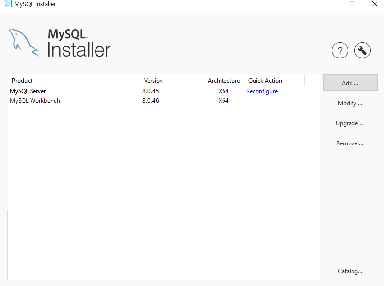
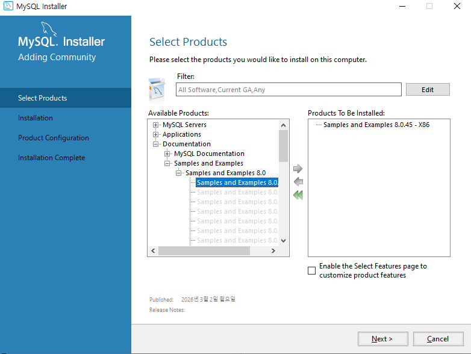
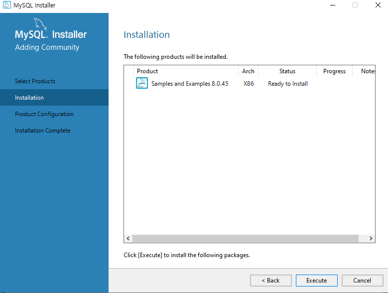
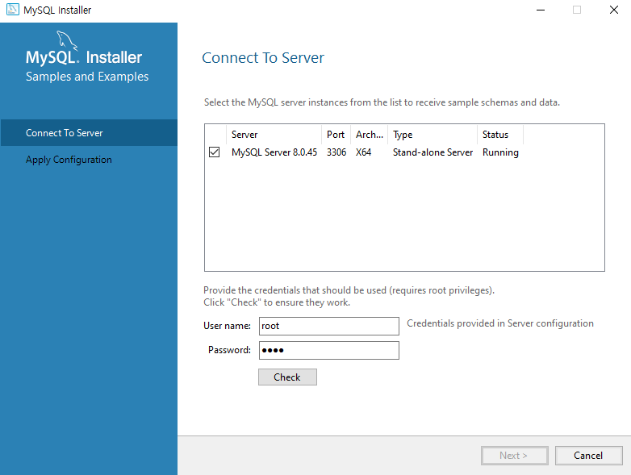
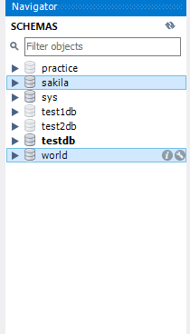
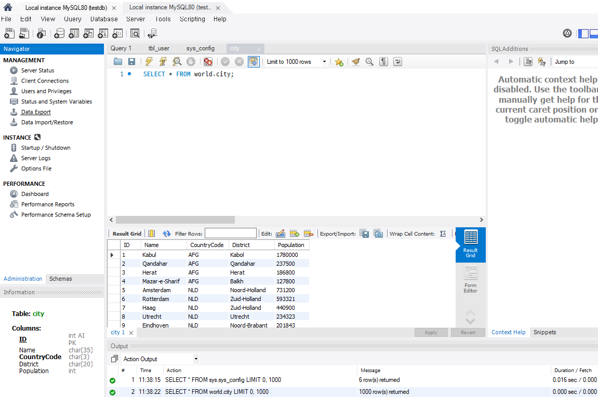
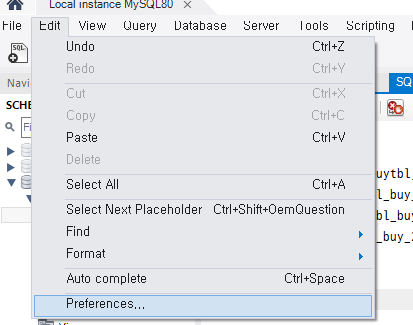
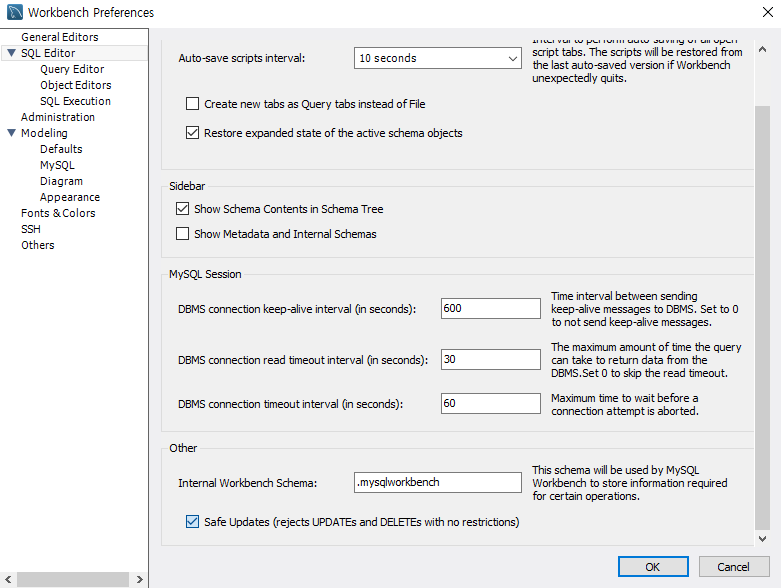

# Install

### MySQL 설치

> MySQL은 가장 많이 쓰는 관계형 데이터베이스 관리 시스템(RDBMS)이다. 데이터를 표(테이블) 형태로 저장하고 SQL로 조회하고 수정한다. [MySQL Community Downloads](https://downloads.mysql.com/)에서 MySQL Installer for Windows(MSI Installer)를 받아 설치한다. 대부분 기본 설정으로 넘기다가 root 비밀번호를 설정한다.

<br>



<br>


Installer에서 Sample and Examples를 함께 선택하면 연습용 샘플 DB(`world`, `sakila`)가 같이 설치된다.

<br>



<br>



<br>



<br>


설치 후 Workbench의 Schemas 목록에서 샘플 DB를 확인한다.

<br>



<br>



<br>


| **DB** | **설명** |
| --- | --- |
| `world` | 국가(`country`), 도시(`city`), 언어(`countrylanguage`) 테이블. 집계와 JOIN 연습 |
| `employees` | 직원, 급여, 부서 테이블. 대용량 데이터로 INDEX 성능 비교. [test_db](https://github.com/datacharmer/test_db)를 받아 `source employees.sql` 명령으로 설치. 받은 파일은 `18_SampleDb`에 있다 |
| `classicmodels`, `shopdb` | 내장 함수, 쇼핑몰 연습용 DB |

- 예제 코드: [employees 샘플 DB](../18_SampleDb/Employees/employees.sql)

---

### 환경변수 설정

> 실행 파일의 전체 경로를 매번 입력하지 않고 어디서든 `mysql` 명령을 쓰도록 `Path`에 MySQL의 `bin` 폴더를 등록한다.

<br>

| **순서** | **설명** |
| --- | --- |
| 1 | 검색창에 `실행`을 입력해 실행창을 열고 `sysdm.cpl`로 시스템 속성 열기 |
| 2 | 고급, 환경 변수, 시스템 변수의 `Path` 선택 후 편집 |
| 3 | 맨 아래 빈 칸에 MySQL의 bin 경로(예: `C:\Program Files\MySQL\MySQL Server 8.0\bin`) 입력 후 확인 |

---

### 접속과 기본 명령어

> 터미널에서 `mysql -u root -p`로 접속한다. `-u`는 사용자, `-p`는 비밀번호 입력이다. 비밀번호를 같은 줄에 붙여 쓸 수도 있지만 노출되므로 입력 창에서 치는 것이 안전하다.

<br>

```sql
mysql -u root -p
mysql -u root -p<PASSWORD>      -- 비밀번호를 함께 입력 (권장하지 않음)
```

<br>

| **명령** | **설명** |
| --- | --- |
| `show databases;` | DB 목록 |
| `use DB명;` | 사용할 DB 선택 |
| `show tables;` | 현재 DB의 테이블 목록 |
| `desc 테이블명;` | 테이블 구조(컬럼, 자료형, null, 키) |
| `select * from 테이블명;` | 데이터 조회 |

<br>

<span style="color:brown">`use`로 DB를 선택하지 않고 테이블을 조회하면 `ERROR 1146: Table doesn't exist`가 난다. 현재 DB가 맞는지 확인한다.</span>

---

### Workbench 설정

> Workbench는 MySQL을 GUI로 다루는 공식 도구다. 쿼리 창에서는 `Ctrl + Enter`로 커서가 있는 줄의 쿼리를 실행한다.

<br>


<br>


Safe Update 모드는 `where` 없는 `update`, `delete`를 막는 안전장치다. 연습할 때 막히면 `Edit, Preferences`의 SQL Editor에서 해제하고 Workbench를 다시 연결한다.

<br>



<br>



<br>

<br>

---

<br>

**Install 요약**

<aside>

> MySQL: RDBMS, Installer로 설치하고 root 비밀번호 설정 <br>
Path에 bin 폴더 등록 후 mysql -u root -p로 접속 <br>
show databases, use, show tables, desc로 구조 확인 <br>
Workbench: GUI 도구, Safe Update 모드 해제 가능

</aside>

<br>

### Link
[MySQL 공식 사이트](https://www.mysql.com/) <br>
[MySQL 8.0 Reference Manual](https://dev.mysql.com/doc/refman/8.0/en/)
