# Ddl

### DDL

> DDL(Data Definition Language)은 데이터베이스와 테이블의 구조를 정의하는 SQL이다. `create`(생성), `alter`(수정), `drop`(삭제)가 있다. 데이터가 아니라 구조를 다룬다.

<br>

---

### DB 생성과 삭제

> DB는 테이블을 담는 그릇(스키마)이다. 명령어(`create database`)나 Workbench 메뉴로 만든다.

<br>

| **방법** | **명령** |
| --- | --- |
| 생성 | `create database test2db;` |
| 삭제 | `drop database test2db;` |

<br>

**Workbench로 생성**

Schemas 영역에서 오른쪽 마우스, Create Schema를 선택하고 이름을 입력한 뒤 Apply를 누른다. 확인 창에서 다시 Apply, Finish를 누르면 목록에 나타난다.

<br>

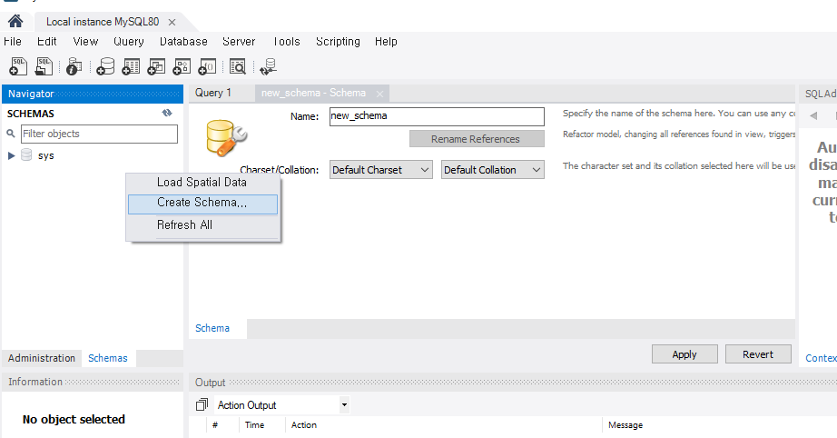

<br>

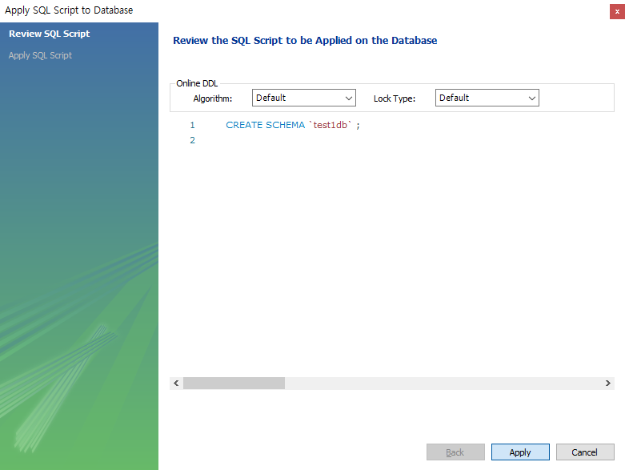

<br>


**Workbench로 삭제**

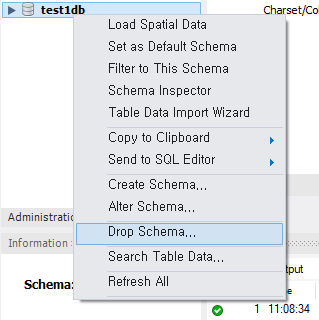

<br>

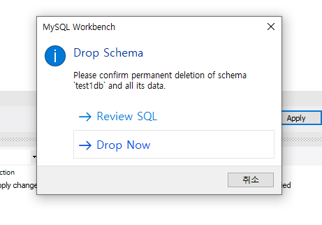

<br>

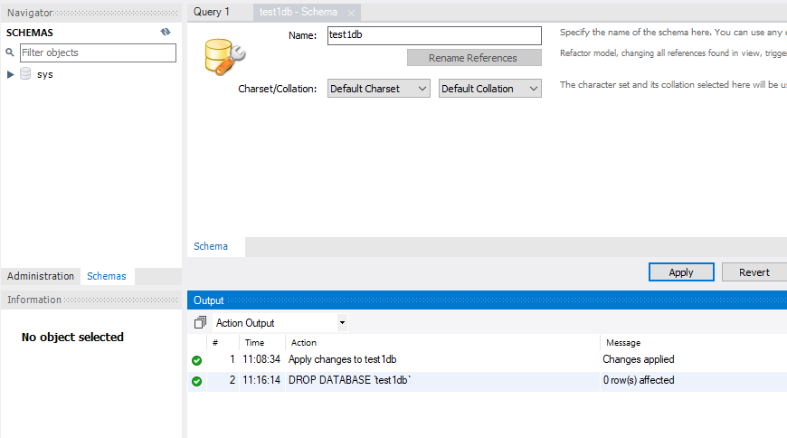

<br>


---

### 테이블 생성

> 테이블은 컬럼(열)과 자료형, 제약조건을 정해 만든다. `primary key`(PK)는 행을 구분하는 유일한 값이다. 이미 `use`로 DB를 선택했다면 `DB명.`은 생략할 수 있다.

<br>

```sql
use test2db;
create table tbl_user(
    userID varchar(45) primary key,
    username varchar(45) null,
    password varchar(255)
);
show tables;
desc tbl_user;
```

<br>

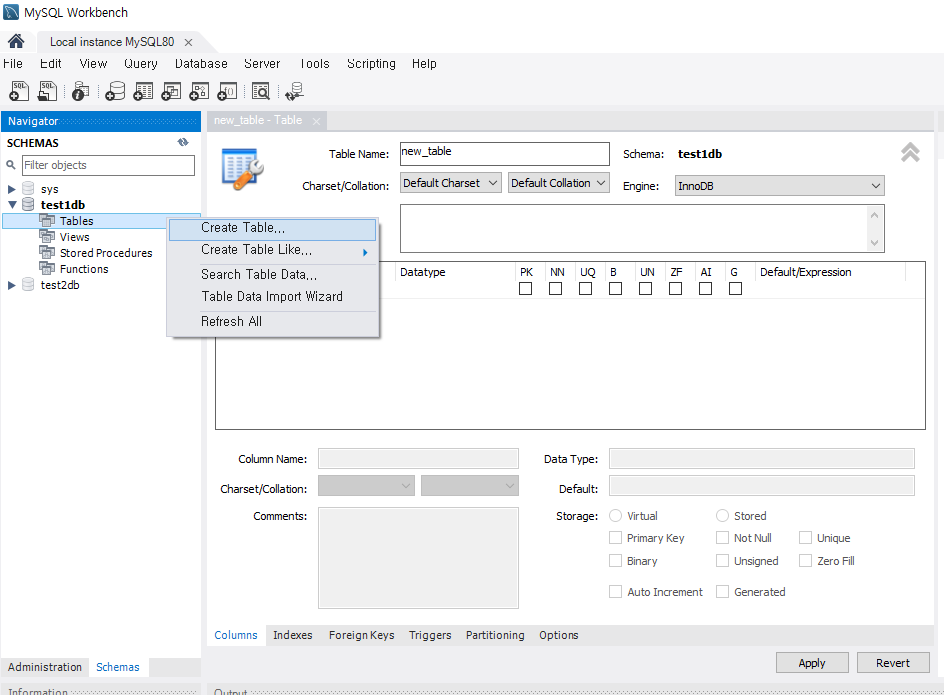

<br>

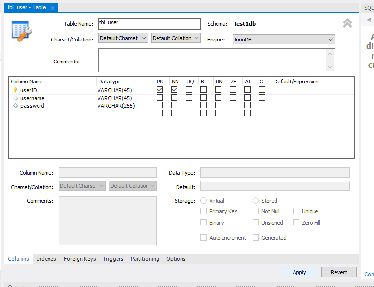

<br>

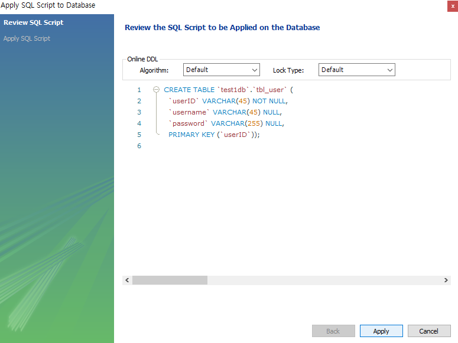

<br>

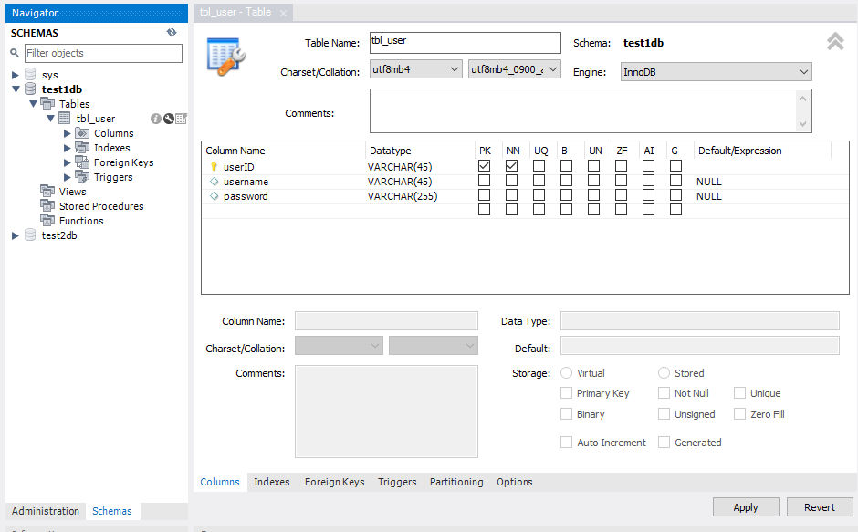

<br>

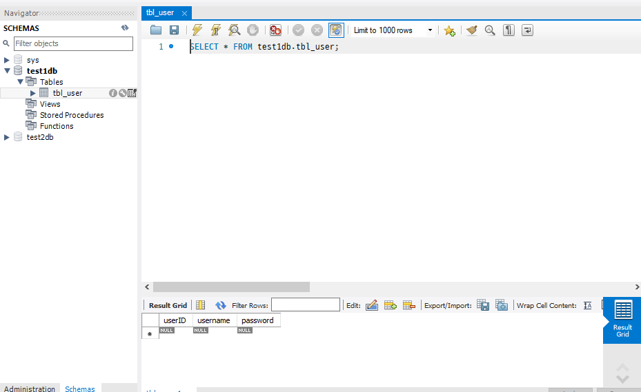

<br>


<span style="color:brown">자료형을 `varcher`처럼 잘못 쓰면 `ERROR 1064: You have an error in your SQL syntax`가 난다. 오류 메시지의 `near` 뒤에 문제 위치가 나온다.</span>

<br>

**문제: tbl_product 생성**

| **컬럼** | **자료형, 제약조건** |
| --- | --- |
| `prod_id` | `int` primary key |
| `prod_name` | `varchar(100)` not null |
| `prod_category` | `varchar(10)` null |
| `prod_details` | `varchar(1024)` null |
| `reg_date` | `datetime` not null |
| `prod_price` | `int` not null |

<br>

```sql
create table tbl_product(
    prod_id int primary key,
    prod_name varchar(100) not null,
    prod_category varchar(10) null,
    prod_details varchar(1024) null,
    reg_date datetime not null,
    prod_price int not null
);
```

---

### 테이블 수정

> `alter table`로 컬럼을 추가, 수정, 삭제한다. 스패너 아이콘으로 Workbench에서도 수정할 수 있다.

<br>

| **작업** | **문법** |
| --- | --- |
| 컬럼 추가 | `alter table 테이블 add column 컬럼 자료형 제약조건 after 기준컬럼;` |
| 컬럼 수정(이름과 자료형) | `alter table 테이블 change column 기존컬럼 새컬럼 자료형 제약조건;` |
| 컬럼 삭제 | `alter table 테이블 drop column 컬럼;` |

<br>

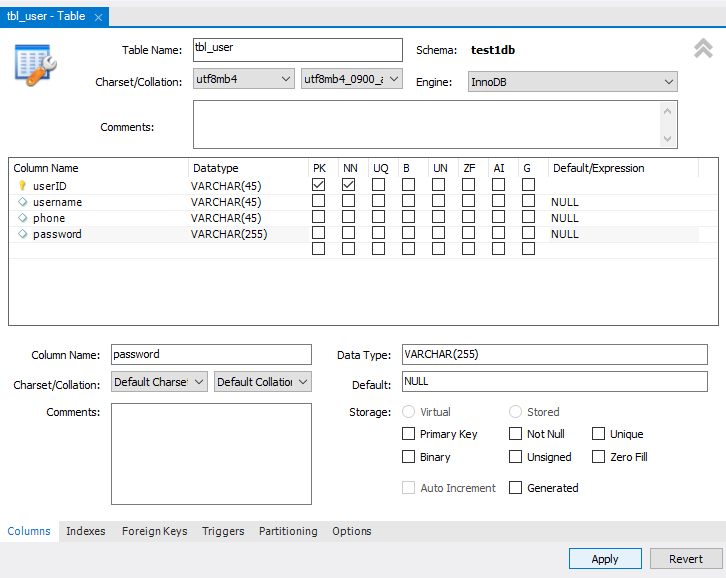

<br>

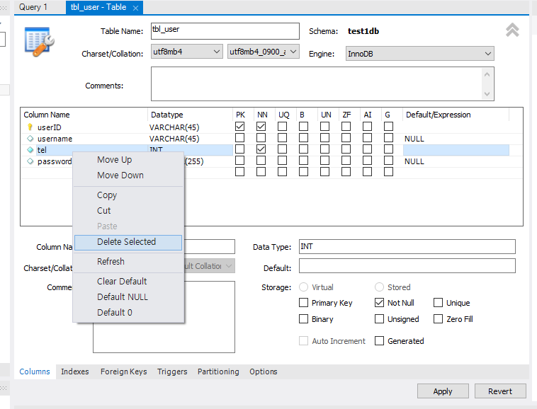

<br>


**문제: tbl_product 수정**

```sql
alter table tbl_product add column amount int not null;                       -- amount 추가
alter table tbl_product change column prod_price price varchar(100) null;     -- prod_price를 price varchar(100) null로 수정
alter table tbl_product drop prod_details;                                    -- prod_details 삭제
```

- 예제 코드: [제약조건과 테이블 구조 변경](../03_Constraint/01Constraint.sql)

<br>

---

<br>

**Ddl 요약**

<aside>

> DDL: create, alter, drop으로 구조 정의 <br>
create database, create table 컬럼 자료형 제약조건 <br>
alter table add column, change column, drop column

</aside>

<br>

### Link
[MySQL CREATE TABLE](https://dev.mysql.com/doc/refman/8.0/en/create-table.html) <br>
[MySQL ALTER TABLE](https://dev.mysql.com/doc/refman/8.0/en/alter-table.html)
