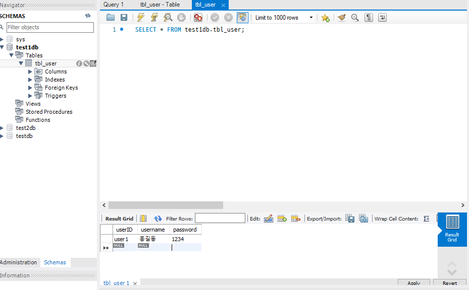
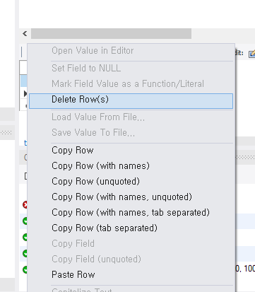

# Dml

### DML

> DML(Data Manipulation Language)은 테이블의 데이터를 넣고 고치고 지우는 SQL이다. `insert`(삽입), `update`(수정), `delete`(삭제)가 있다.

<br>

| **명령** | **문법** | **설명** |
| --- | --- | --- |
| insert | `insert into 테이블 values(값, ...);` | 모든 컬럼의 값을 순서대로 입력 |
| insert(컬럼 지정) | `insert into 테이블 (컬럼, ...) values(값, ...);` | 지정한 컬럼만 입력. 나머지는 `null` |
| update | `update 테이블 set 컬럼=값 where 조건;` | 조건에 맞는 행 수정 |
| delete | `delete from 테이블 where 조건;` | 조건에 맞는 행 삭제 |

<br>

<span style="color:brown">`update`와 `delete`에 `where`를 빼면 모든 행이 바뀌거나 지워진다. 반드시 조건을 지정한다.</span>

<br>

```sql
insert into tbl_user values('aaa','01011111111','1234');
insert into tbl_user (userID,tel) values('bbb','01022222222');
update tbl_user set tel='01055555555', password='9999' where userid='bbb';
delete from tbl_user where userid='bbb';
```

<br>

Workbench에서는 결과 표(Result Grid)에서 값을 직접 입력하거나 행을 오른쪽 마우스로 삭제(Delete Row)한 뒤 Apply한다.

<br>



<br>



<br>


- 예제 코드: [INSERT, UPDATE, DELETE](../02_Dml/01InsertUpdateDelete.sql)

---

### insert 옵션

| **옵션** | **설명** |
| --- | --- |
| 여러 행 한 번에 | `values (...), (...), (...);` |
| `insert ignore` | PK가 중복되면 오류 없이 건너뛰고 다음 문장 실행 |
| `auto_increment` | 새 행이 들어올 때 고유 번호를 자동 증가. `null`을 넣으면 자동 부여 |
| `on duplicate key update` | PK가 중복되면 insert 대신 지정한 값으로 update |
| `last_insert_id()` | 마지막으로 성공한 auto_increment 값 |

---

### 문제: tbl_product

**1. INSERT** 아래 데이터를 추가한다.

| **prod_id** | **prod_name** | **prod_category** | **reg_date** | **prod_price** | **amount** |
| --- | --- | --- | --- | --- | --- |
| 1111 | LG_GRAM_2023 | 가전 | 2024/01/22 | 830,000 | 100 |
| 1112 | SAMSUNG_FLEX2 | 가전 | 2024/01/22 | 3,000,000 | 50 |
| 2000 | 대우_통돌이_01 | 가전 | 2024/01/22 | 590,000 | 25 |
| 3001 | 이것이리눅스다 | 도서 | 2023/01/22 | 30,000 | 1000 |

**2. UPDATE** `prod_category`가 '가전'인 모든 행의 `reg_date`를 '2023/01/01'로 변경한다.

**3. DELETE** `prod_id`가 1111인 행을 삭제한다.

```sql
insert into tbl_product (prod_id, prod_name, prod_category, reg_date, prod_price, amount)
values
('1111','LG_GRAM_2023','가전','2024/01/22','830,000','100'),
('1112','SAMSUNG_FLEX2','가전','2024/01/22','3,000,000','50'),
('2000','대우_통돌이_01','가전','2024/01/22','590,000','25'),
('3001','이것이리눅스다','도서','2023/01/22','30,000','1000');

update tbl_product set reg_date='2023/01/01' where prod_category='가전';
delete from tbl_product where prod_id='1111';
```

<span style="color:brown">`update ... set reg_date='...', where` 처럼 `where` 앞에 쉼표를 붙이면 문법 오류가 난다. 컬럼명 오타(`pod_category`)는 `Unknown column` 오류가 난다.</span>

<br>

---

<br>

**Dml 요약**

<aside>

> DML: insert, update, delete로 데이터 조작 <br>
update와 delete는 where로 대상 지정 필수 <br>
insert ignore, auto_increment, on duplicate key update

</aside>

<br>

### Link
[MySQL INSERT](https://dev.mysql.com/doc/refman/8.0/en/insert.html) <br>
[MySQL UPDATE](https://dev.mysql.com/doc/refman/8.0/en/update.html)
