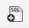
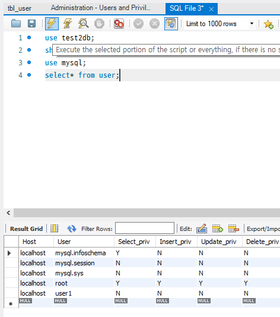

# User

### 사용자 계정

> DB 사용자는 `이름@접속 위치`로 구분한다. `localhost`는 같은 컴퓨터에서만, `%`는 모든 IP에서 접속할 수 있다. 계정 정보는 `mysql` DB의 `user` 테이블에 저장된다. Workbench에서는 Administration의 Users and Privileges에서 관리한다.

<br>

| **명령** | **설명** |
| --- | --- |
| `create user 이름@localhost identified by '비밀번호';` | 로컬 접속 계정 생성 |
| `create user 이름@'%' identified by '비밀번호';` | 원격 접속 가능 계정 생성 |
| `select user, host from mysql.user;` | 계정 목록 확인 |
| `drop user 이름@localhost;` | 계정 삭제 |

<br>



<br>



<br>


다른 컴퓨터에서 접속할 때는 `mysql -u 계정 -p -h <HOST_IP>`처럼 `-h`로 서버 주소를 지정한다.

---

### 권한

> `grant`로 권한을 주고 `revoke`로 회수한다. 권한 대상은 `DB명.테이블명`으로 지정하고 `DB명.*`은 DB 전체다.

<br>

| **명령** | **설명** |
| --- | --- |
| `grant select on test2db.* to user30@localhost;` | 읽기 권한 |
| `grant select, insert, update on test2db.* to user30@localhost;` | 읽기, 쓰기, 수정 권한 |
| `grant all privileges on test2db.* to user40@'%';` | 모든 권한 |
| `show grants for 이름@host;` | 부여된 권한 확인 |
| `revoke insert on test2db.* from user30@localhost;` | 권한 회수 |
| `flush privileges;` | 변경한 권한을 즉시 반영 |

---

### 문제

**단계 1: 로컬 계정 관리**

```sql
-- 1 localhost에서만 접속 가능한 intern_admin 계정 생성 (비밀번호: <PASSWORD>)
create user 'intern_admin'@'localhost' identified by '<PASSWORD>';
-- 2 mysql.user 테이블에서 intern_admin의 이름과 접속 범위 확인
select user, host from mysql.user where user = 'intern_admin';
-- 3 intern_admin 계정 삭제
drop user 'intern_admin'@'localhost';
```

**단계 2: 외부 접속 및 권한 부여**

```sql
-- 4 모든 IP(%)에서 접속 가능한 dev_user 생성
create user 'dev_user'@'%' identified by '<PASSWORD>';
-- 5 project_db의 모든 테이블에 SELECT, INSERT, UPDATE 권한 부여
grant select, insert, update on project_db.* to 'dev_user'@'%';
-- 6 부여된 권한 확인
show grants for 'dev_user'@'%';
```

**단계 3: 권한 회수 및 정리**

```sql
-- 7 project_db에 대한 모든 권한 회수
revoke all on project_db.* from 'dev_user'@'%';
-- 8 dev_user 계정 삭제
drop user 'dev_user'@'%';
-- 9 변경한 권한을 서버에 즉시 반영
flush privileges;
```

<br>

---

<br>

**User 요약**

<aside>

> 계정: create user 이름@localhost 또는 @'%' identified by 비밀번호 <br>
권한: grant 권한 on DB.* to 계정, revoke로 회수, show grants로 확인 <br>
flush privileges로 즉시 반영

</aside>

<br>

### Link
[MySQL 계정 관리](https://dev.mysql.com/doc/refman/8.0/en/access-control.html)
