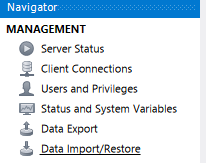
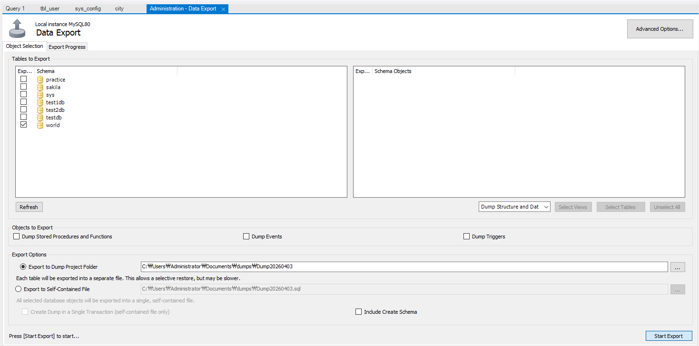
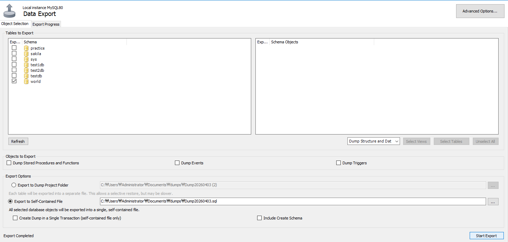
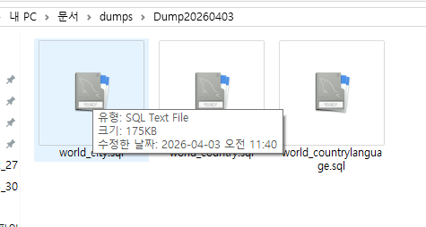
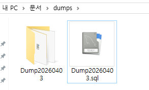
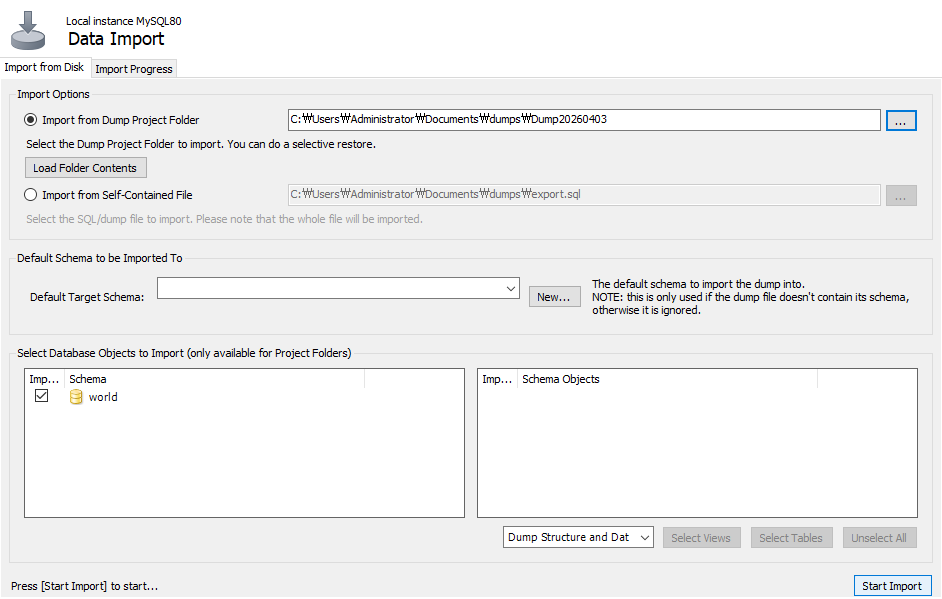
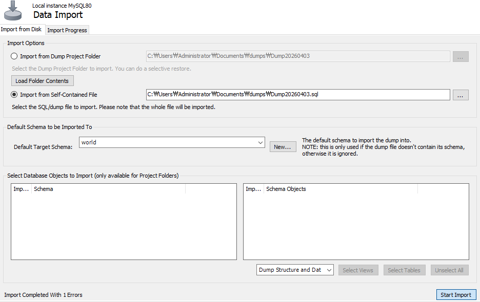

# Backup

### 백업과 복원

> 백업은 DB의 구조와 데이터를 `.sql` 파일로 내보내는 것이고, 복원은 그 파일을 실행해 되살리는 것이다. 명령어(`mysqldump`)나 Workbench의 Data Export, Data Import로 한다.

 

**명령어**

| **작업** | **명령** |
| --- | --- |
| 한 DB 백업 | `mysqldump -u root -p world > world_backup.sql` |
| 전체 DB 백업 | `mysqldump -u root -p --all-databases > all_backup.sql` |
| 한 테이블 백업 | `mysqldump -u root -p world city > world_city_backup.sql` |
| 복원 | `mysql -u root -p < all_backup.sql` |
| 복원(mysql 안에서) | `source all_backup.sql` |

 

비밀번호를 `-p<PASSWORD>`처럼 명령에 붙이면 노출 경고가 나온다. `-p`만 쓰고 입력 창에서 입력한다.

 

**Workbench**

Navigator의 Management에서 Data Export, Data Import/Restore를 선택한다. 내보낼 스키마와 테이블을 고르고 폴더 또는 단일 파일로 저장한다.

 

 

 

 

 

 

복원은 Data Import에서 폴더(`Import from Dump Project Folder`) 또는 단일 파일(`Import from Self-Contained File`)을 선택한다.

 

 

 

- 예제 코드: [전체 DB 백업](../17_Backup/AllBackup.sql)
- 예제 코드: [world DB 백업](../17_Backup/WorldBackup.sql)
- 예제 코드: [world city 테이블 백업](../17_Backup/WorldCityBackup.sql)

 

---

 

**Backup 요약**

<aside>

> 백업: mysqldump -u 사용자 -p DB > 파일.sql  
복원: mysql -u 사용자 -p < 파일.sql 또는 source  
Workbench의 Data Export, Data Import 사용

</aside>

 

### Link
[mysqldump](https://dev.mysql.com/doc/refman/8.0/en/mysqldump.html)
