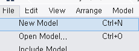
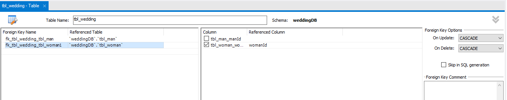
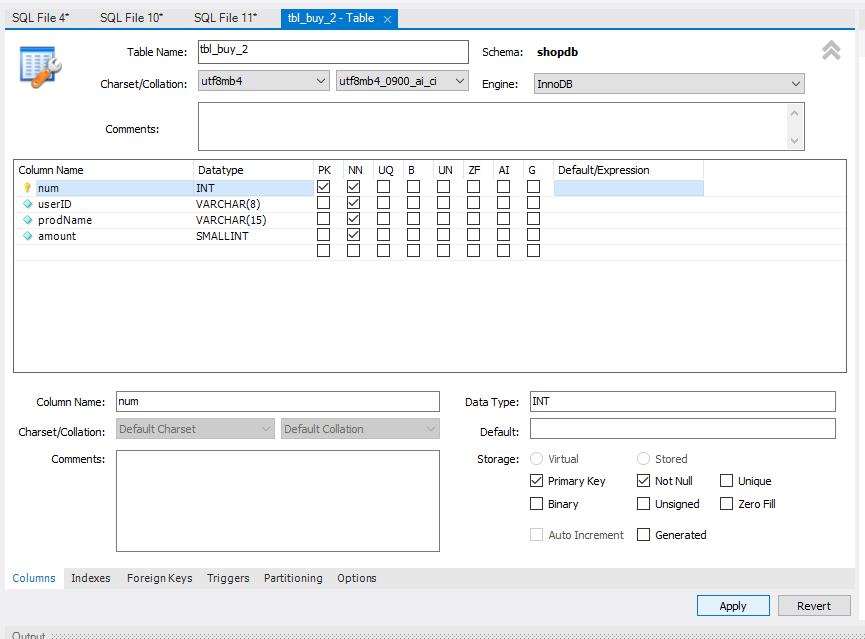
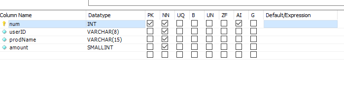
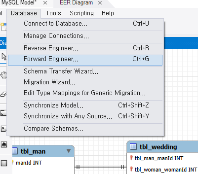
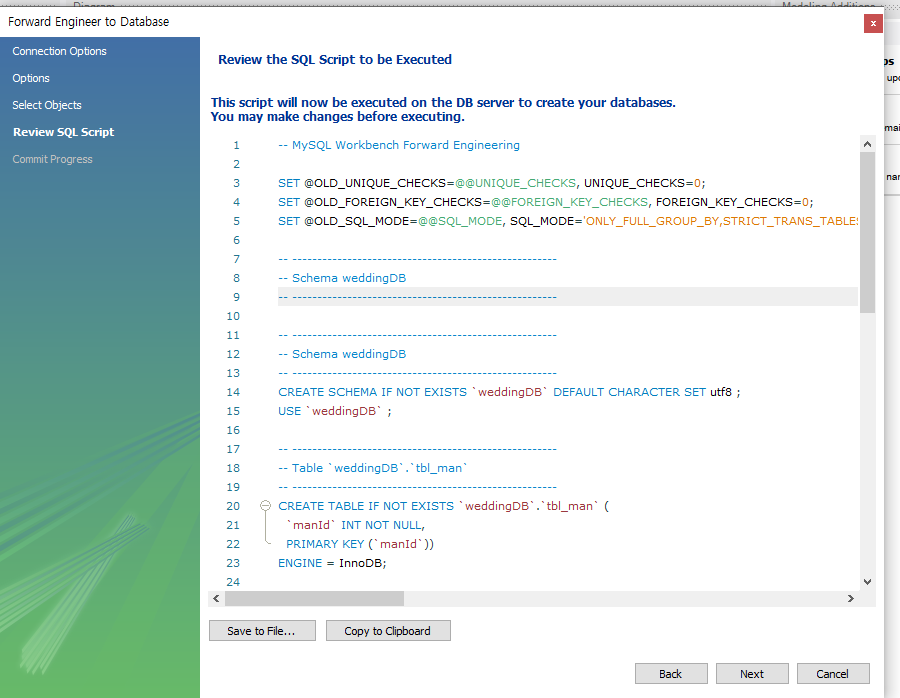
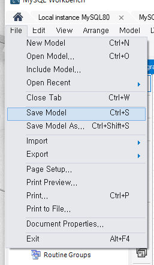
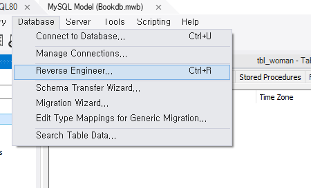
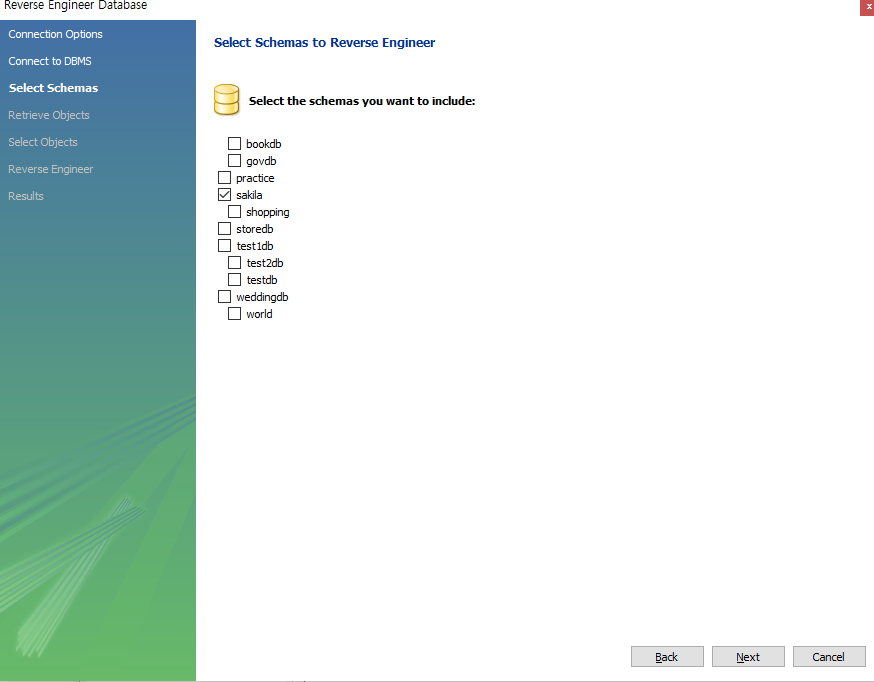

# Modeling

### ERD 모델링

> Workbench의 모델링 기능으로 테이블 관계도(ERD)를 그리고, 그 모델로 DB를 만들거나(Forward Engineer) 기존 DB에서 모델을 만든다(Reverse Engineer). 모델 파일은 `.mwb`다.

 

**새 모델 만들기**

File, New Model로 모델을 만들고 테이블을 추가해 컬럼을 입력한다.

 

 

 

 

컬럼 편집창에서 키와 속성을 체크한다.

| **약어** | **설명** |
| --- | --- |
| PK | 기본키 |
| NN | Not Null |
| UQ | Unique |
| AI | Auto Increment. 값이 자동으로 1씩 증가 |

 

 

외래키 관계를 만들 때는 `On Update`, `On Delete`를 `cascade`로 지정하면 부모 값 변경이 자식에도 반영된다.

 

**Forward Engineer, 모델에서 DB 만들기**

Database 메뉴의 Forward Engineer를 선택하면 모델이 DB 생성 쿼리(SQL Script)로 바뀐다. 과제를 낼 때는 이 쿼리를 복사해 제출한다.

 

 

 

 

**Reverse Engineer, DB에서 모델 만들기**

이미 있는 DB를 열어 Database 메뉴의 Reverse Engineer로 모델을 만든다.

 

 

 

 

- 예제 코드: [Book DB 모델](../16_Model/BookDb.mwb)
- 예제 코드: [지문 DB 모델](../16_Model/FingerprintDb.mwb)
- 예제 코드: [쇼핑 DB 모델](../16_Model/Shopping.mwb)
- 예제 코드: [매장 DB 모델](../16_Model/StoreDb.mwb)
- 예제 코드: [웨딩 DB 모델](../16_Model/WeddingDb.mwb)

 

---

 

**Modeling 요약**

<aside>

> 모델링: Workbench에서 ERD를 그리고 .mwb로 저장  
PK, NN, UQ, AI 속성 지정  
Forward Engineer는 모델에서 DB 생성, Reverse Engineer는 DB에서 모델 생성

</aside>

 

### Link
[MySQL Workbench 모델링](https://dev.mysql.com/doc/workbench/en/wb-data-modeling.html)
